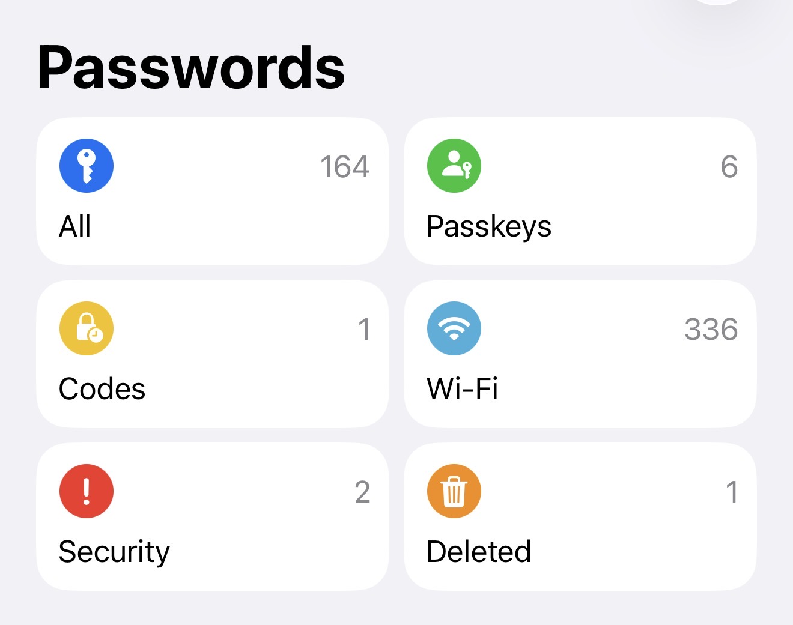
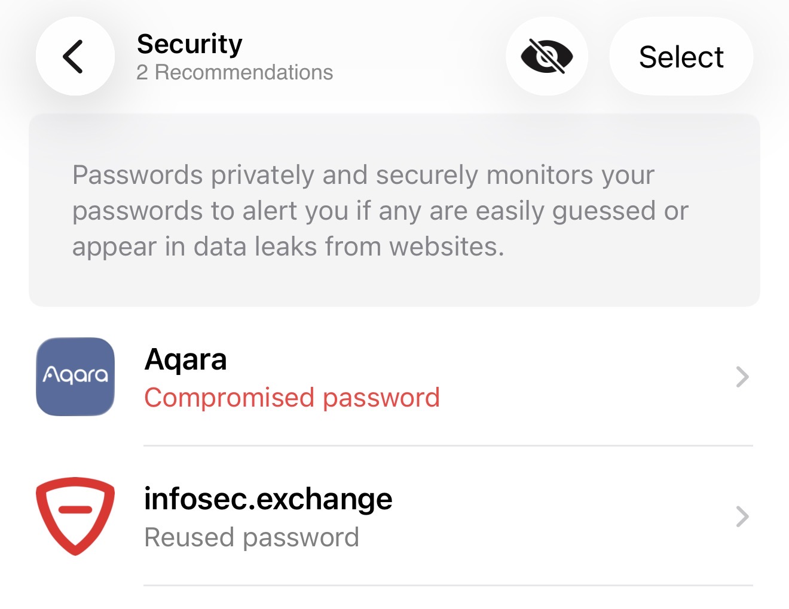
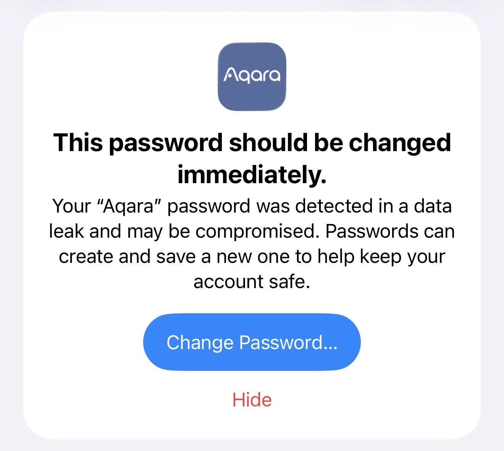

# Password

The main principle: **never use the same or similar passwords.**

For two reasons:
- An email and password leaked from one site are often tried on others afterwards — your mailbox,
Instagram, Amazon — and that is how accounts get broken into. Nobody has to be after you
personally for that: hacked accounts are a commodity, and the market for them is large.
- If your accounts and passwords surfaced in [leaks](./breaches.md), a shared password ties
together even completely different emails and phone numbers. That is how journalists
[tied ten email addresses to one man](https://meduza.io/feature/2022/02/07/eto-pohozhe-na-krik-dushi-no-ya-ne-znayu-o-chem-on-krichit)
(the story is in Russian).

The second reason matters more for privacy. A shared password links your accounts as firmly as
a shared phone number: it works as one more identifier of yours. **Changing the password does not
erase that link: the "email and password" record stays in the leak forever.** So never reuse
a password you have already had somewhere, not even on a brand-new account.

## Password managers

You do not have to remember a hundred passwords. You need to remember one — the one for your
password manager.

A password manager is a program that makes up passwords, stores them and fills in the right one on
the right site. **If your phone or browser offers to "save password" and you agree, you are
already using one:** on an iPhone it is the Passwords app, in Chrome and on Android it is Google
Password Manager.

Start with the one you already have:
[check which of your passwords have already leaked](#check-your-passwords-against-leaks).

The one password you need to remember is, for a built-in manager, the password of your Apple or
Google account; for a standalone program, its master password.

The account that holds your passwords now opens everything else, so give it extra protection:

- turn on two-factor authentication for it: signing in then takes a code as well as the password.
Look for it in the account's security settings, and pick a method other than SMS codes if you can
([why](./2fa.md));
- set a phone passcode longer than four digits and do not type it where others can watch:
**whoever knows the passcode and takes the phone can open every saved password.** On an iPhone
turn on Stolen Device Protection (Settings → Face ID & Passcode): with it, away from home and
work, passwords open only with your face or fingerprint, and the passcode alone is not enough;
- do not install cracked software on your computer: it can bring along a virus that pulls out
your passwords — from the browser and from text files on your desktop alike.

A manager does one more thing, less noticeable: it fills in a password only on the site it was
saved for. If you open a sign-in page and the manager does not offer the password, check the
address: it may not be the site you saved. People rarely spot the difference between
`paypal.com` and `paypa1.com` by eye, while the manager does.

A manager cannot protect a sign-in code: you type that in yourself. **Enter codes only on a site
you went to yourself, not through a link in a message, and never read them out to anyone.** That
is how Telegram accounts get hijacked: sign-in there is by code, and unless you have set
a two-step verification password, the code is all a thief needs. Set one: Settings → Privacy and
Security → Two-Step Verification.

A built-in manager keeps passwords in your Apple or Google account. Passwords from an iPhone will
not show up on Android on their own — you will have to move them — and on a Windows computer you
need Apple's iCloud for Windows app. A standalone manager is tied to neither Apple nor Google: it
works the same on any phone and computer.

It is better not to keep passwords in the browser on a computer: a virus gets them out of there
easily. Keep them in a standalone manager, where they are encrypted with the master password.

Of the standalone managers we recommend [Bitwarden](https://bitwarden.com/): its code is open, so
any specialist can check how it handles passwords. The free version stores any number of
passwords, works on any number of devices, can keep card numbers and notes, and generates both
ordinary passwords and passwords made of random words. Checking all saved passwords against leaks
at once is a paid feature.

Passwords are stored on Bitwarden's servers encrypted, and only your master password can decrypt
them — which is why it has to be strong. All saved passwords can be exported to a file, in case
you ever lose access to the service. Unless you pick the encrypted format when exporting, the
passwords in the file are in plain text: do not leave it in your downloads and do not send it to
anyone.

Write the Bitwarden master password down on paper and keep it at home. **If you forget it, nobody
can recover it, Bitwarden included** — and all the saved passwords are gone with it.

If you do not want your passwords on someone else's servers, there is
[KeePassXC](https://keepassxc.org/): it keeps them in a single encrypted file on your computer.
You will have to carry that file to your other devices yourself, and on a phone you will need
a separate app.

## Check your passwords against leaks

A built-in manager checks this on its own. On an iPhone, open the Passwords app and go to
Security; in Chrome and on Android, open Password Checkup in Google Password Manager. It shows
**which passwords have already turned up in leaks and which ones you reuse on several sites.**

If a password has turned up, it is already being tried in break-ins. Change it everywhere you
used it — the same section shows the list. Change your email password first: every other password
can be reset through your mailbox. Then banks and government services, then shops where your card
is saved.
The rest can be changed gradually, as you visit each site.

Here is how: on the site or in the app, open the account settings and find the option to change
the password.
In the new password field your phone or browser usually suggests a random one — accept it, and it
is saved. Afterwards check that the manager holds the new password, not the old one.

A password that is not saved anywhere can be checked at
[Pwned Passwords](https://haveibeenpwned.com/Passwords), a database of passwords from known
leaks. The password itself is not sent there: the page turns it into an irreversible code and
sends only the first five characters of that code. The codes of about two thousand other
passwords start with the same five characters, and the service cannot tell which one is yours.
If you would rather not type a password into someone else's page, just change it.

For what else about you is in the leaks, see the [Data leaks](./breaches.md) chapter.

## How to come up with strong passwords

"Eight characters, letters, digits and a special character" is a poor requirement: `P@ssw0rd`
meets it.

A password is usually guessed not on the site itself but against a database leaked from it. The
passwords in it are most often stored as hashes — irreversible codes — and a program tries
variants until the code matches. How fast that goes depends on how the site stored passwords, and
you cannot know that in advance. Sometimes the passwords sit in the database in plain text, and
then there is nothing to guess.

Attackers try a short password in full, character by character. For a long one they take
a dictionary — words and passwords from earlier leaks — and apply the usual rules to every word:
**append a year, capitalise the first letter, replace letters with lookalike digits and
symbols.** The closer your password is to that pattern, the faster they find it.

### What to do: a password of random words

You only have to make up one password yourself — the one that opens the manager: your Apple or
Google account password, or the master password of a standalone program. The manager makes up the
rest: when you sign up or change a password, it suggests a random one — accept it. The manager's
own password, though, you will have to remember and type by hand, so build it from words. Until you have
memorised it, keep it written down on paper at home.

The advice "think of three random words" does not work: people do not come up with random things.
The words that come to mind are from one topic, from a recent conversation, or start with the
same letter, and such combinations are guessed quickly.

So the words have to arrive ready-made. The
[Bitwarden generator](https://bitwarden.com/password-generator/) hands them out — right on the
page, with no sign-up; the phrase is put together in your browser and is not sent anywhere.
Choose Passphrase there, and you get something like
`decal-running-early-reflex-judicial-onshore`.
What matters:

- take six words: every added word makes guessing several thousand times longer;
- keep the words that came up: replacing one with your favourite makes the password predictable.
If you get a word you do not know, press again and take a whole new phrase;
- separate the words with hyphens or spaces.

Such a phrase cannot be guessed even by someone who knows which list the words came from: there
are too many combinations to try in a human lifetime.

### What not to do

Two tricks are recommended most often, and neither works. The first is replacing letters with
lookalike digits and symbols: `password` as `p@ssw0rd`, `sunshine` as `5un5h1n3`.
Password-guessing programs do this on their own: having taken a word from a dictionary, such
a program immediately tries all those spellings of it too. The list of substitutions ships as
a ready-made file with hashcat, the best known password-guessing program, and is switched on with
a single option at launch.

The second trick is typing a word in the wrong keyboard layout: typed on a Latin keyboard, the
Russian tongue twister `ехалгрекачерезреку` becomes `t[fkuhtrfxthtphtre`. Guessing dictionaries are
converted to another layout automatically, and the trick is so popular that such passwords
already sit in the dictionaries as ready strings. Kaspersky
[went through](https://www.kaspersky.com/blog/passwords-hacking-research-2026/55743/)
231 million passwords from leaks, Russian ones among them, and
[called](https://www.anti-malware.ru/news/2026-05-07-111332/49963) this trick popular (that
summary is in Russian).
**The leaked passwords include `gfhjkm` (the Russian for "password" typed on a Latin keyboard), `vfvf`
("mum"), `gfgf` ("dad"), and the reverse direction — `мдфв` from `vlad`.** The same study found
that length alone does not save you: one in five 15-character passwords is guessed in under
a minute if it was built from a familiar pattern and the site stored passwords in an outdated
way — MD5 in the study.

## Signing in without a password

A passkey is a way to sign in without a password. The site asks your phone or computer, and the
device confirms that it is you — with your fingerprint, face or PIN. There is no password at all. The
site keeps only a key it uses to check your phone, and nobody can sign in with that key.

What this gives you:

- **your key cannot be taken from a leak of the site** — the site does not have it. The old
password still works, though: as long as it is valid, someone can sign in with it, so change it
to a random one;
- **a fake page does not work**: the key is bound to the site's address, and on a fake site the
browser will not offer it. Such a site may ask for a password or an SMS code instead of the key —
do not enter them where you normally sign in with a key.

There is a caveat. The keys are stored in your Apple or Google account, or in a standalone manager,
and travel between your devices encrypted. That account becomes the key to everything else:
whoever takes it over can get all your sign-ins at once.

Services also call other things "passwordless sign-in": a code by SMS, or biometrics with the
sample stored on their server. Then the sign-in is tied to your phone number or to a face
template that is not in your hands. With a passkey, your fingerprint and face never leave the
phone — just as when you open a banking app with Face ID.

Support changes fast, so check for yourself: look for "passkey" in the service's security
settings. A Google account is a place to start: it supports passkeys.

## LessPass

What if storing passwords and syncing them between devices is too much trouble? There are
password managers that store nothing at all. They suit those who do not want to keep passwords in
anyone's cloud.

[LessPass](https://www.lesspass.com/) is the best known of them. It generates each password on
the fly with a function that always gives the same result for the same inputs.

You tell the program:
- your master password
- your login on the site
- the site address

It then generates your password without sending or saving anything. You can run the program on
any device at any time and get the same password for that site.

This approach has a downside too. The master password cannot be changed on its own: change it, and
all your passwords change at once. And if some site demands a password change or does not accept
the generated one, you will have to remember which of the program's settings you changed for it.

There is a risk as well. If the password for one site leaks in plain text, it can be used to
guess the master password, and all the others are derived from the master one. So the master
password here has to be as strong as for an ordinary manager.

## Useful materials and links to sources

- [Free LessPass password manager runs on a pure function](https://www.pvsm.ru/open-source/207324)
(in Russian)

---

[⬅️ Back](./location.md) | [⏫ Table of contents](../README.md) | [➡️ Next](./photo.md)
